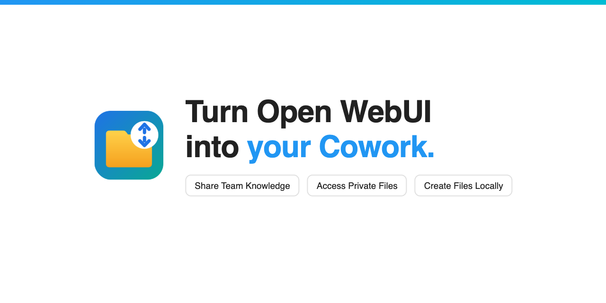
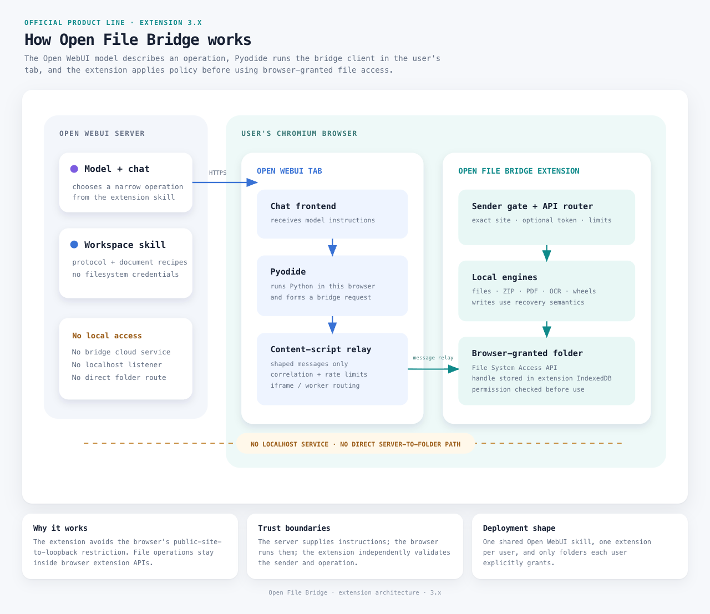
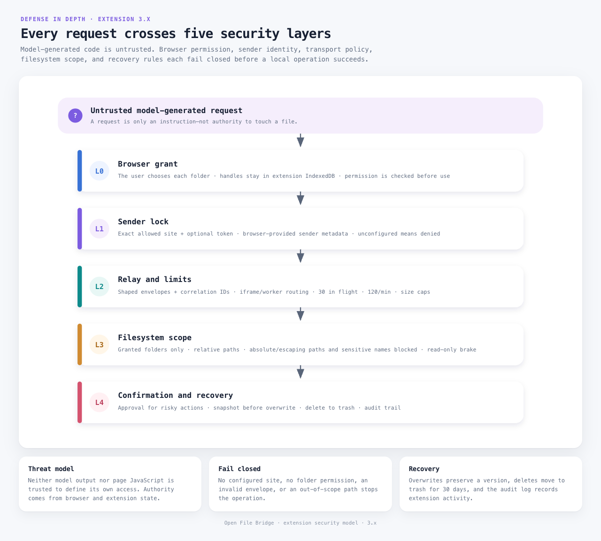

<p align="center">
  
</p>

# Open File Bridge

**Turn [Open WebUI](https://github.com/open-webui/open-webui) into your
Cowork — with your team's shared knowledge, your private files, and all
the document work done on your own machine.**

What that means:

- **Share team knowledge** — your org's workspace knowledge stays in Open
  WebUI, server-side, exactly as it is today
- **Access private files** — each user opens one folder of their own
  machine to the chat; files never touch the server
- **Create files locally** — Word/Excel/PowerPoint/PDF creation, format
  conversion and OCR all run on the user's machine, so file work scales
  with users, not your server

Built for and verified against Open WebUI (0.10.x and 0.11.x). The
**browser extension is the official product line**. It keeps file access
inside the user's browser and does not require a localhost service.

## Product lines and versioning

| Product line | Versions and release tags | Status | Transport |
|---|---|---|---|
| Browser extension | `3.x`; tags `v3.*` | **Official; active development** | Open WebUI page relay → extension → user-granted folder |
| Desktop application | `2.x`; tags `app-v2.*` | **Legacy; maintenance only** | Pyodide → `http://127.0.0.1:8765` → application → configured folder |

The versions are intentionally independent. A `v3.*` tag packages and
publishes the cross-platform extension; an `app-v2.*` tag builds the legacy
application for Windows, macOS, and Linux. Skill text also has its own
revision and declares the **minimum** compatible extension. It is not kept in
lockstep with either executable.

### Why the extension is now official

The desktop application depends on model-generated Pyodide code being allowed
to contact a loopback HTTP service. On a public HTTPS Open WebUI deployment,
current Chromium local-network protections can block that request from Open
WebUI's default opaque-origin sandbox before it reaches the application. CORS
headers and a bridge token cannot repair a request the browser never sends.

The extension removes that dependency: the skill talks through a constrained
page/worker message relay, and the extension works directly with a folder the
user selected through the browser. There is no resident process, listening
port, per-OS installer, or local-network permission prompt.

The legacy application remains available for compatible localhost/LAN Open
WebUI deployments and environments that permit browser-to-loopback access. It
also retains native-only behavior such as LibreOffice conversion and opening
files in the operating system. It receives compatibility and security fixes,
but new product development targets the extension.

```
User: "read notes.txt in my folder"
  └─ Open WebUI model (your server) ── generates Python code
       └─ Pyodide runs it IN THE USER'S BROWSER
            └─ postMessage / BroadcastChannel → extension relay
                 └─ extension reads/writes ONE browser-granted folder
```



## Why you'd want this

- **Zero server-side file handling** — works for 10 or 10,000 users with no
  per-user infrastructure, no MCP servers, no tunnels, no cloud drives.
- **Local access by architecture** — there is no Open File Bridge cloud
  service or direct server-to-folder route. Requested results return through
  the allowed Open WebUI page, where normal chat/model data policies still
  apply.
- **Real office work, not toys** — Word/Excel/PowerPoint/PDF creation and
  editing, OCR of scanned documents, mail merge, zip/unzip, versioned writes
  with a trash bin and a full audit log.
- **Model-guided** — extension skills carry complete transport and document
  recipes in plain and token-authenticated variants; only successful bridge
  responses count as work completed on the user's machine.

## How it works

Open WebUI's Code Interpreter (Pyodide engine) is WebAssembly Python that
executes **in the user's browser**. A public **Skill** teaches the model the
extension's narrow message protocol; a **model preset** turns the Code
Interpreter on by default so users just pick a model and ask. The extension
validates the sending site and requested operation before touching a file.

| Piece | Where it lives | This repo |
|---|---|---|
| Extension skill (plain/token variants) | OWUI Workspace | `skill/open-file-bridge/SKILL-EXT*.md` |
| Open File Bridge extension | Each user's Chromium browser | `extension/` |
| Legacy desktop application | Each user's machine | `src/file_bridge.py` + `build/` |

The current extension integration depends on Open WebUI's browser-side
Pyodide engine. Open WebUI describes Pyodide as a legacy engine, so a future
transport independent of Pyodide remains an explicit compatibility goal.

## Security model

Model-generated code is treated as **untrusted**. A request must pass
every layer below before touching a file:



- **L0 Browser grant** — the user explicitly selects the folder through the
  browser; its handle is stored locally in extension IndexedDB.
- **L1 Sender lock** — the extension accepts only the exact Open WebUI site
  configured by the user, with an optional bridge token as a second lock. A
  fresh extension fails closed until a site is allowed.
- **L2 Transport policy** — only shaped bridge messages cross the page relay;
  requests and responses are correlated, rate-limited, and size-capped.
- **L3 Filesystem gate** — only browser-granted folders are visible; absolute
  paths and `../` escapes are rejected, and credential-looking filenames
  (`id_rsa`, `.env`, `*.pem`…) are blocked outright.
- **L4 Operation semantics** — risky operations require confirmation. Every
  overwrite snapshots the prior version first; deletes are trash-moves (purge
  is 403 by design); restores are themselves snapshotted. The capped audit log
  scrubs secrets, and read-only mode plus the write-rate breaker provide extra
  brakes. Users can browse versions/trash via chat and tune safety settings on
  the extension's 🛟 Safety card.

## Setup

### Official browser extension

1. **Install Open File Bridge 3.x** from the Chrome Web Store. Version 3.7.0
   (tester-round fixes) is the current packaged version. For development or
   pre-release testing, download the extension ZIP from the latest `v3.*`
   [GitHub release](https://github.com/Sparkling-AI/open-file-bridge/releases),
   extract it, and use Chrome/Edge → Extensions → Developer mode → Load
   unpacked.
2. **Open the extension settings**, choose the folder to share, and set the
   exact allowed Open WebUI site. Optionally configure a bridge token.
3. **Publish the matching extension skill** in Open WebUI: use
   [`SKILL-EXT.md`](skill/open-file-bridge/SKILL-EXT.md) when the extension
   has no token, or
   [`SKILL-EXT-TOKEN.md`](skill/open-file-bridge/SKILL-EXT-TOKEN.md) when it
   does. Replace the token placeholder before publishing the token variant.
4. **Enable Code Interpreter and attach the skill** to the Open WebUI model.
   Both the model capability and its default feature switch must be enabled.
5. Start a new chat and ask: *"List the files in my shared folder."*

The current `scripts/setup_owui.py` automates the legacy application skill
variants, not the extension variants. Extension setup is manual until that
script is migrated.

Full Store submission and reviewer details are in
[docs/CHROME-WEB-STORE.md](docs/CHROME-WEB-STORE.md).

## Legacy desktop application setup

The instructions below apply only to the `2.x` desktop application. Use this
line when the Open WebUI browser execution context is permitted to reach
`127.0.0.1:8765`, typically with a local or private/LAN Open WebUI deployment.
It is not the recommended path for public HTTPS deployments: the browser can
block the loopback request before CORS or token authentication takes place.

### Admin (once) — manual setup

What the setup script automates, spelled out so you can do it (and audit it)
by hand in the Open WebUI UI:

1. **Publish the skill** — *Workspace → Skills → Create*: set id
   `open-file-bridge`, paste the contents of
   [`skill/open-file-bridge/SKILL.md`](skill/open-file-bridge/SKILL.md)
   (the **no-token variant** — right when users' bridges run tier-1
   origin-lock, or with per-user tokens told in chat), save — then set
   the skill's visibility to **public** (users need read
   access or their models can't load it). Going with an org-wide token
   instead? Publish the **token variant**
   [`SKILL-TOKEN.md`](skill/open-file-bridge/SKILL-TOKEN.md) with your
   org token in its `X-Bridge-Token` line — see step 4.
2. **Create the assistant model (custom model)** — *Workspace → Models →
   Create*: base it on a strong chat model, then under
   **Capabilities** enable **Code Interpreter** *and* mark it as a
   **default** feature — **both switches matter**: with only the capability
   checked, new chats start with the interpreter toggle OFF and the model
   can never run code. Under **Skills**, attach `open-file-bridge`.
   (Weak models that wander into the sandbox? Publish the stricter
   `SKILL-STRICT.md` as a second skill + second model.)
3. **Distribute the legacy app** — point users at the `app-v2.*`
   [GitHub Releases](https://github.com/Sparkling-AI/open-file-bridge/releases)
   (per-OS zips + `SHA256SUMS`; macOS build is signed & notarized since
   2.8.1) or mirror the zips internally — or users run from source with
   `python3 src/file_bridge.py <folder>` (zero pip dependencies).
4. **Set up an access token when the compatible execution context sends
   `Origin: null`** — tier-1 origin lock alone cannot authenticate that
   opaque origin. A token solves the authentication/CORS layer, but it cannot
   bypass a browser-level local-network block. Two options, each with its own
   skill variant, keep the model from guessing:
   - **Org token (zero per-user chat friction):** generate one org token
     (any strong random string), publish the **token variant**
     `SKILL-TOKEN.md` as the skill with the token filled into its
     `"X-Bridge-Token": "__ORG_TOKEN__"` line (the setup script does this
     with `--bridge-token <secret>` — it also refuses to publish a token
     variant without one). The skill then carries exactly ONE
     `BRIDGE_HEADERS` definition, token included — weak models can't get
     it wrong.
   - **Per-user private tokens (strongest):** publish the no-token
     `SKILL.md`. Each user generates their own token in the app; when the
     model hits HTTP 401 the skill's recovery block asks the user for it
     once in chat and applies it for the session (or the user embeds it
     in their own private copy of `SKILL-TOKEN.md` — see
     [solo setup](#solo-setup-no-admin-staging--private-skill--your-own-app)).
   - Either way: **users paste the same token into their bridge** (app
     settings page → 🔒 Security → token field) — org token, or their
     private one.
   - Org-token caveat: everyone in the org can read the token from the
     public skill body — by design: it's a company-boundary credential
     (stops local malware and other websites from using the bridge), not
     a secret from colleagues. Avoid with guest/external accounts; use
     per-user tokens then.
   - **Rotating**: re-run the script with a new `--bridge-token` (or
     re-publish the skill with the new token in the `X-Bridge-Token`
     line) and tell users to re-paste into the app.
5. Sanity-check the result as a user (checklist below).

Scripted shortcut for steps 1–2 and the token embedding in 4 (idempotent,
same REST calls, no code changes to Open WebUI):

```bash
python3 scripts/setup_owui.py --url http://your-owui:8080 \
    --email admin@… --password '…' --base-model glm-5.3-flash \
    --bridge-token '<org-token>'
# weaker models (they wander into the sandbox instead of the bridge)?
# add a strict-variant preset with fixed recipes + verify-after-write:
python3 scripts/setup_owui.py … --variant-strict-model glm-4.5-air
# or make strict the ONLY skill (org standardizes on small models):
python3 scripts/setup_owui.py … --variant strict
```

### User checklist

Preconditions — confirm these before anything else:

- [ ] **Allowed by your admin**: a local-files assistant model appears in
      your model list (usually "Local Files Assistant") — that means the
      skill is published and Code Interpreter pre-enabled for you
- [ ] **The org token from your admin** (if your org uses one): you'll
      paste it into the app once — request it if you weren't given it
- [ ] **The legacy app**: find the latest `app-v2.*` Open File Bridge release
      under [Releases](https://github.com/Sparkling-AI/open-file-bridge/releases)
      (or whatever internal mirror your admin points you to — run from
      source works too: `python3 src/file_bridge.py <folder>`)
- [ ] **Browser**: Chrome, Edge or Firefox — *not* Safari (it blocks the
      localhost fetches this needs)

Then:

1. **Install & launch the app**, pick the folder you want to share — the
   settings page opens in your browser.
2. **Paste the org token** your admin gave you into the settings page
   (🔒 Security → token) — the chat then uses it automatically (it's
   embedded in the org skill). Until this is done the bridge stays
   locked and every file request fails — that's by design. (No org
   token? Generate your own with *Generate random token* instead.)
3. **New chat → select the assistant model** → ask something like
   *"list the files in my folder"*. If the browser asks about
   **local network access**, click **Allow**.
4. **Using your own model instead of the preset?** Two extra switches:
   enable the **Code Interpreter** toggle in the chat's feature bar, and
   enable/[$-mention](docs/user-guide.md) the `open-file-bridge` skill.
   Everything else is identical.

Full walkthrough incl. permission prompts and troubleshooting:
[docs/user-guide.md](docs/user-guide.md).

### Solo legacy setup (no admin staging — private skill + your own app)

If your org hasn't staged a public skill and presets — or you're on a
server where you're just a regular user — you can run the whole thing
yourself. Your skill stays **private to you** (colleagues can't even see
it, let alone read a token embedded in it — verified on current builds:
a private skill is invisible to other users in the skill list).

**One-time ask to your OWUI admin** (regular users can't create skills
by default — the *Workspace → Skills* permission is off unless granted):
"please enable **Skills** (and ideally **Models**) creation for users"
— Admin Panel → Settings → Users & Permissions → Workspace. It's two
checkboxes, no staging on their side.

Then:

1. **Get the legacy app** yourself: download your OS bundle from the latest
   `app-v2.*` entry under
   [Releases](https://github.com/Sparkling-AI/open-file-bridge/releases)
   (per-OS install steps: [user guide](docs/user-guide.md#install--first-run))
   or run from source (`python3 src/file_bridge.py <folder>`).
2. **Create a private skill** — your OWUI *Workspace → Skills → Create*:
   paste **`SKILL-TOKEN.md`** (the **token variant** — keep it private,
   visibility stays "only me") and fill **your personal token** into its
   `"X-Bridge-Token": "__ORG_TOKEN__"` line (replace `__ORG_TOKEN__`
   with your token). The skill then has exactly one `BRIDGE_HEADERS`
   with your token baked in — no chat handoff needed. With a private
   skill this token is visible to you alone, which is strictly better
   security than the shared org-token pattern. (Prefer telling the model
   the token in chat each session instead? Use the no-token `SKILL.md`
   — its 401-recovery block asks for the token when needed.)
3. **Bridge side**: launch the app, pick your folder, paste the same
   token in settings (🔒 Security → *Generate random token* gives you
   one; or use its value in the skill).
4. **Chat with any code-capable model**: enable the **Code Interpreter**
   toggle in the chat feature bar and `$`-mention your private skill
   (e.g. `$my-open-file-bridge`) — or if user model creation is enabled,
   build your own preset with the interpreter + skill attached and skip
   the per-chat toggling.

Why this works: the bridge runs on *your* machine and only ever checks
the token — it doesn't care who published the skill. Solo mode trades
the org preset's convenience for zero admin staging and a token nobody
else can read.

## Legacy app model-validation results

Real-browser chat runs, asserting the file **actually lands on disk**
(not claimed in prose) — harness and evidence in
[docs/ROADMAP.md](docs/ROADMAP.md) §multi-model smoke:

| Model | Skill | Result |
|---|---|---|
| glm-5.3 | standard | ✅ full flow: /list → /read → /write, file on disk |
| glm-5.3 | standard, unified description | ✅ no regression |
| glm-5.2 | standard | ✅ honest failure when bridge unreachable (stops, no fabrication) |
| glm-4.5-air | strict, old description | ❌ fabricated success (wrote to Pyodide virtual FS, zero bridge calls) |
| glm-4.5-air | strict, failure-mode description | ✅ full bridge flow, file on disk |

Key lesson (validated both ways): models are only guaranteed to see a
skill's **name + description** — the description must state the failure
mode ("files written with `open()/os` are LOST and INVISIBLE to the
user"), not list features. Both shipped skill variants carry this wording.

## Compatibility

| | Status |
|---|---|
| Open WebUI | Extension verified with the browser-side Pyodide transports used by 0.10.x/0.11.x; re-test every minor release |
| Official extension | Chrome/Edge desktop with the File System Access API; no localhost or local-network permission required |
| Legacy application | Windows 10/11, macOS 11+, Linux; requires an OWUI/browser context that may reach `127.0.0.1:8765` |
| Python (legacy app from source) | 3.8+, zero pip dependencies for the core; optional add-ons enable OCR/PDF endpoints |

## Repository layout

```
├── extension/                    # official 3.x browser extension
├── skill/open-file-bridge/       # extension + legacy-app OWUI skill variants
├── .github/workflows/extension.yml # extension CI + v3.* GitHub releases
├── src/file_bridge.py            # legacy 2.x desktop app
├── build/                        # legacy per-OS packaging
├── .github/workflows/build.yml   # legacy app-v2.* builds/releases
├── scripts/setup_owui.py         # legacy app skill/preset setup
├── tests/e2e_test.sh             # 215 endpoint + security assertions
├── tests/addon_test.sh           # 136 add-on suite (Office/PDF/OCR/convert)
└── docs/                         # guides, compat window, support runbook, diagrams
```

## Documentation

| Doc | For |
|---|---|
| [CHROME-WEB-STORE.md](docs/CHROME-WEB-STORE.md) | official extension publishing and reviewer checklist |
| [user-guide.md](docs/user-guide.md) | legacy app end-user installation and first chat |
| [admin-guide.md](docs/admin-guide.md) | legacy app deployment and hardening |
| [OWUI-COMPAT.md](docs/OWUI-COMPAT.md) | legacy app compatibility history and upgrade checks |
| [SUPPORT.md](docs/SUPPORT.md) | legacy app SmartScreen, port 8765, and Safari runbook |
| [BUILDING.md](docs/BUILDING.md) | building the legacy per-OS packages |
| [MICROSOFT-STORE.md](docs/MICROSOFT-STORE.md) | free Store/MSIX publishing checklist |
| [PRIVACY.md](docs/PRIVACY.md) | privacy-policy source for Store publication |
| [RCLONE.md](docs/RCLONE.md) | mounting cloud drives into the shared folder |
| [ROADMAP.md](docs/ROADMAP.md) | design decisions, verified results, history |
| [DEVNOTES.md](docs/DEVNOTES.md) | every gotcha we hit (agent-friendly) |

## What this is not

- Not a file-sync or RAG system — it's live read/write of the current
  folder contents into the chat.
- Not a way to bypass the user: the browser requires the user to choose and
  grant each folder, and the extension serves only enabled grants.
- Not currently Firefox or Safari compatible: the official product uses
  Chromium extension and File System Access APIs.

## License

Apache-2.0 — open for any use, with patent grant. See [LICENSE](LICENSE),
[NOTICE](NOTICE) (attributions to OpenWorker & Open WebUI openapi-servers),
and [CLA.md](CLA.md) (contributions).
